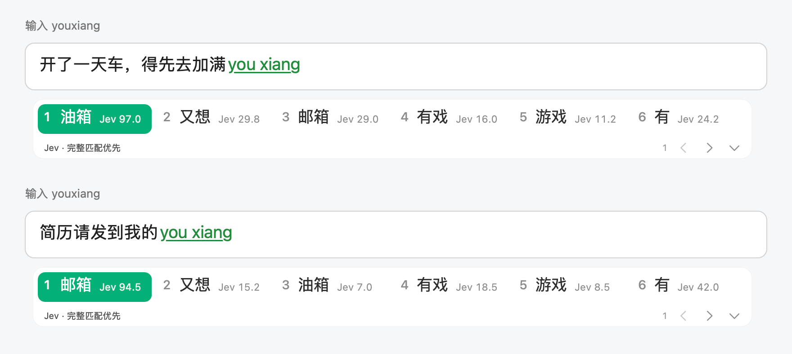
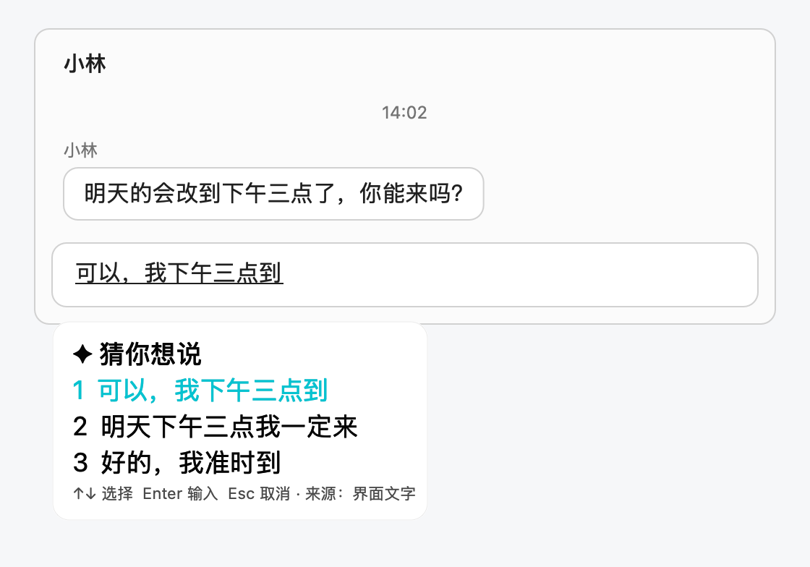

# 轻言输入法

支持 Jev 的 AI 输入法。

macOS 原生中文 / 英文 / 离线语音输入法，当前为 **0.1.16 开发预览版**，需要 Apple Silicon 和 macOS 14 及以上。

## Jev 上下文选词

同样输入 `youxiang`，轻言会根据光标前的文字给候选排序：说到加油，首位是「油箱」；说到发简历，首位是「邮箱」。



- [TypeSafe](https://docs.typesafe.ai) 的 Jev 模型给 Rime 前 20 个候选打 0–100 分，分数显示在候选旁。完整匹配拼音的词优先，同组内按分数排序。
- 你常选的词仍然排在前面：同一拼音下，确认过的词按次数和最近使用时间优先，个人记录只存在本机。
- 候选先即时显示，停顿 180 毫秒后再评分。超时或出错时保留本地顺序，不影响打字。
- **开启**：「轻言设置与语音状态… → Jev 选词」中填入自己的 TypeSafe API Key，打开「启用 Jev 云端选词」。
- **数据**：开启后，光标前最多 128 个字符、当前拼音和候选会发送到 TypeSafe。不开启时打字完全离线。

## 猜你想说

在输入框里按 **Control + Option + G**，轻言读取当前窗口的内容，用本机模型猜三句你可能要说的话。Enter / Tab 上屏，只填入不发送。



- 先通过辅助功能读取界面文字，读不到时截取当前窗口，用 macOS 自带的文字识别。只读输入框所在的那一栏，例如微信右侧的聊天记录。
- 猜测由本机 Qwen3 4B 完成，模型加载后约 1.5 秒出结果。截图只在内存中识别，不保存、不上传。
- **开启**：安装 [Ollama](https://ollama.com) 并运行 `ollama pull qwen3:4b-instruct`，然后在「轻言设置与语音状态… → 猜你想说」中打开，并按提示授权辅助功能或屏幕录制。
- 4B 模型可能猜错，发送前请检查。

## 其他功能

- **拼音**：Rime 全拼，[雾凇拼音](https://github.com/iDvel/rime-ice) 词库加八股文语法模型，按上下文组句。六列候选，↓ 展开。
- **离线语音**：按住 **Control + Option + Space** 说话，文字边说边出现，松开定稿，Esc 取消。内置 SenseVoice 模型，在本机运行，无需 API Key。快捷键可在设置中更换。
- **中英切换**：单按 Shift 切换英文，未确认的拼音按原始字母上屏。
- **常用词**：在设置中填写专有名词，打字和语音纠错都会用到。
- **本地纠错、用词统计**：可选功能，默认关闭，数据都在本机。

## 安装

从 [Releases](https://github.com/choiking/Qingyan/releases/latest) 下载 `Qingyan-<版本>-arm64.zip`，双击解压。应用尚未经 Apple 公证，需在「终端」中运行：

```sh
xattr -dr com.apple.quarantine ~/Downloads/LocalInput.app
mkdir -p ~/Library/Input\ Methods
mv ~/Downloads/LocalInput.app ~/Library/Input\ Methods/
```

注销并重新登录后，在「系统设置 → 键盘 → 文本输入 → 编辑」中点 **+**，添加「简体中文」下的 **轻言输入法**。第一次使用语音时，在输入法菜单的「轻言设置与语音状态…」中授予麦克风权限。

卸载：删除 `~/Library/Input Methods/LocalInput.app`，再注销重新登录。

## 从源码构建

需要 Xcode 和 Python 3：

```sh
python3 Scripts/bootstrap.py
bash Scripts/build.sh
bash Scripts/test.sh
bash Scripts/install.sh
```

`bootstrap.py` 按 `dependencies.lock.json` 中的版本和 SHA-256 下载依赖。`build.sh` 默认用本机生成的固定签名「Qingyan Local Signing」签名，重新构建后系统权限不会失效。`python3 Scripts/update-dictionary.py` 更新雾凇词库，`bash Scripts/uninstall.sh` 卸载。

## 隐私

- 语音识别、本地纠错和猜你想说都在本机运行；录音和截图只在内存中处理。
- 只有开启 Jev 选词后，才会把上面列出的有限上下文发送到 TypeSafe。API Key 单独保存，权限 0600。
- 设置、词库和选词记录保存在 `~/Library/Application Support/LocalInput`，不记录完整按键日志。

## 已知限制

尚未完成 Developer ID 签名与公证，也尚未完成各主流应用的完整手动兼容性检查。语法模型和语音识别都可能出错，详见 `VALIDATION.md`。

## 许可

**GPL-3.0**，见 `LICENSE`。构建产物包含 GPL-3.0 的雾凇拼音词库、librime-octagram 插件，以及 LGPL-3.0 的语法模型；第三方声明见 `THIRD_PARTY.md`。
